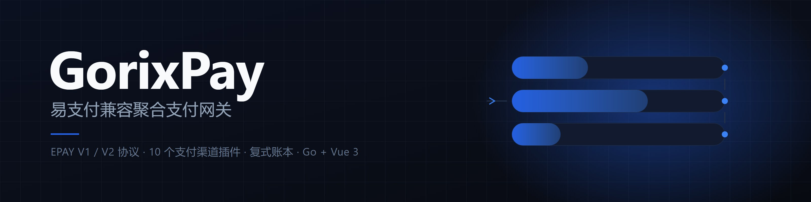
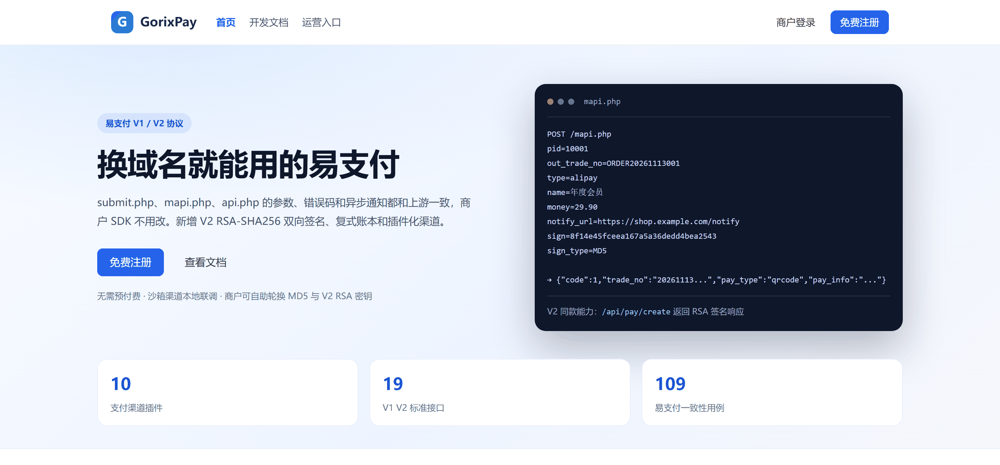
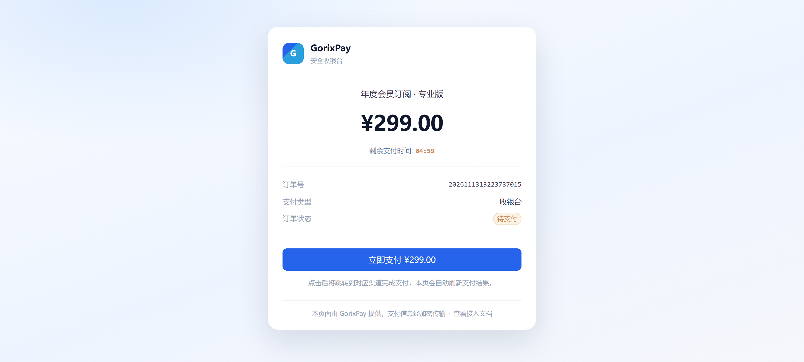
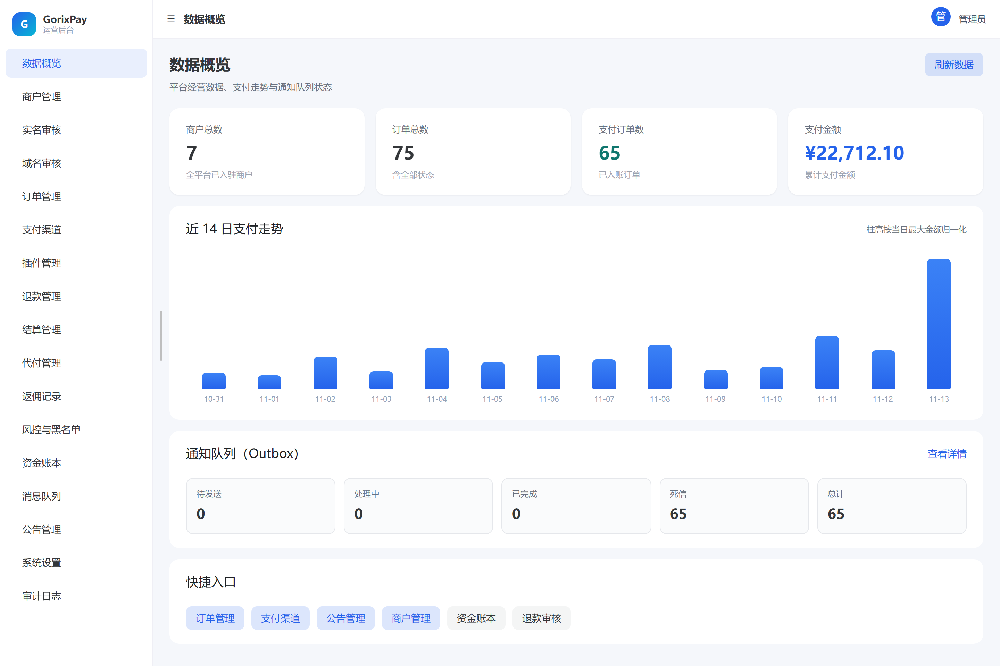
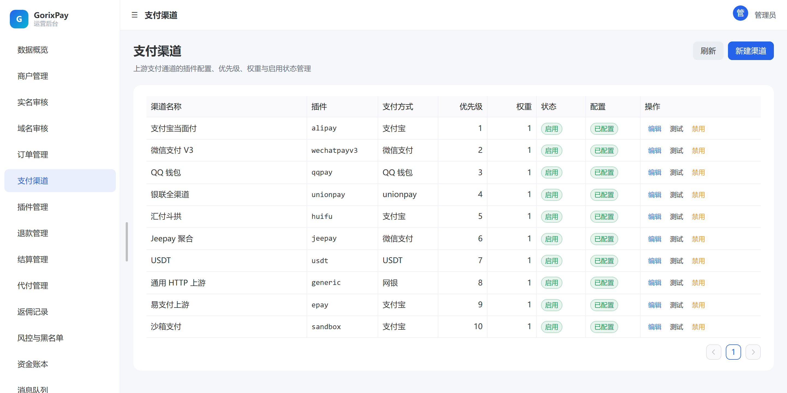
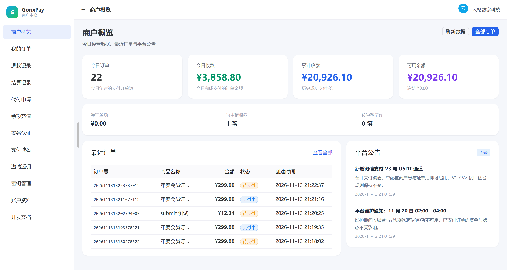
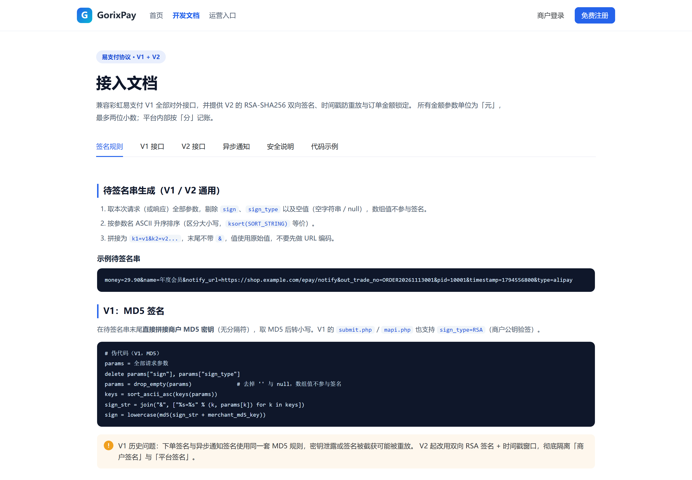
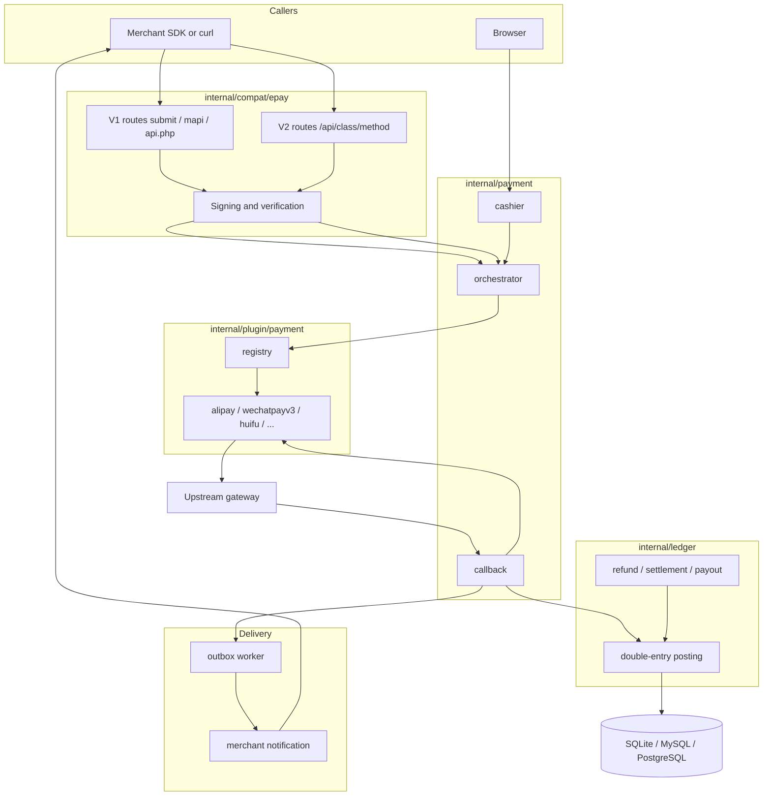

<p align="center">
  
</p>

<p align="center">
  <a href="https://github.com/Wu-jiyan/GorixPay/actions/workflows/ci.yml"></a>
  
  
  
  
  
</p>

<p align="center">
  <a href="README.md">中文</a> ·
  <a href="docs/README.md">Docs</a> ·
  <a href="docs/epay-compat-matrix.md">Compatibility matrix</a> ·
  <a href="docs/plugins.md">Plugin guide</a>
</p>

GorixPay is a Go rewrite of Epay (彩虹易支付), the PHP payment gateway whose `submit.php` / `mapi.php` / `api.php` surface this project reproduces. Change the endpoint host from `pay.example.com` to your domain and existing integrations keep working, with no edits to request formats, response fields, error codes, or the async notification handler on the merchant side.

The PHP original is a monolith: merchant balances stored as columns on the user table, 642 PHP files of which 55 live under `admin/` and 36 under `user/`, channel logic spread across 63 `plugins/` directories, MD5 signatures by default with per-merchant RSA keys as an option. This rewrite adds a V2 API (RSA-SHA256 on both directions, timestamp window, replay protection), a double-entry ledger, and a plugin layer for payment channels. The protocol surface is guarded by 109 conformance cases, and a subset of them runs real PHP against the upstream source to compare signature bytes.

## What works today

| Area | State |
| --- | --- |
| Epay V1: `submit.php`, `mapi.php`, `api.php?act=query\|order\|orders\|refund\|refundapi\|settle`, `submit2.php`, `/pay/{action}/{trade_no}/` | Done, 109 conformance cases |
| Epay V2: 12 methods under `pay/*`, `merchant/*`, `transfer/*`, reachable as `/api.php?s=class/method` too | Done, signed responses and replay protection |
| Payment channels | 10 plugins; Huifu has created a 0.01 CNY order on the live gateway |
| Frontend | 36 Vue pages on Naive UI: landing, cashier, merchant console, admin console |
| Money | Integer-cent double-entry ledger, refunds, settlement, payout, balance top-up, deposit |
| Settlement automation | Rules on minimum amount, fee rate and period; generated settlements, batch approval, automatic payout after approval, checked every minute and idempotent per day |
| Profit sharing and red packets | Receiver list with rates, split inside the payment transaction for ledger receivers, retry on failure; red packets created per batch with random amounts that add up |
| Merchant groups | Groups with fee rate (basis points), allowed payment types and settlement mode, applied by settlement and profit sharing |
| Reports and exports | Buyer stats, merchant stats with fee estimate, daily stats, merchant ledger records; eight CSV exports with BOM and truncation notice |
| Reliability | Transactional outbox with lease-based claiming and CAS updates, notification retries, optional Redis |
| Legacy migration | `cmd/migrate-epay`, MySQL or SQLite into GorixPay, preflight, dry run, idempotent |
| Releases | `v2.0.0` (2026-11-13), the first tag |

## Screenshots

Taken from a locally running instance seeded by `scripts/e2e.ps1`.

| Landing | Cashier |
| --- | --- |
|  |  |
| **Admin overview** | **Payment channels** |
|  |  |
| **Merchant console** | **Developer docs** |
|  |  |

## 17 deviations found by the conformance run

Driving the upstream `EpayCore` client SDK against the rewrite exposed these. Left alone, an official SDK either reads empty fields or throws:

| Symptom | Upstream reference | Fix |
| --- | --- | --- |
| `mapi.php` returned only `pay_type`/`pay_info`; the SDK reads flat fields and parsed nothing | `includes/lib/Payment.php:246-296` | Emit `payurl`/`qrcode`/`urlscheme`/`html`, keep the old keys as aliases |
| Notifications were sent as a POST body, so `$_GET` verification on the merchant side could never pass | `includes/functions.php:519-522` | GET with a query string |
| Notification format was chosen by whether the merchant had an RSA credential, silently switching V1 integrations to RSA | `includes/functions.php:503` | New `payment_orders.version` column, format follows the order |
| Browser never returned to `return_url`, so `verifyReturn()` had nothing to verify | `includes/functions.php:519-531` | Added `/pay/submit`, `/pay/checkpay`, `/pay/return`, `/pay/ok` and the cashier bounce |
| Auth failures returned HTTP 401; upstream never returns 4xx, and .NET/Java clients throw on it | `includes/functions.php:1430` | JSON endpoints answer 200 with an error code, pages answer 200 with the sysmsg template |
| `method`/`device`/`auth_code`/`is_applet` were not parsed at all, so scan and JSAPI flows could not start | `includes/lib/api/Pay.php:296-321` | Wallet inferred from barcode prefix like `getScanPayType` does (25-30 Alipay, 10-15 WeChat, 91 QQ), buyer persisted |

The four auth branches stay separate the way upstream keeps them: missing `pid` is `-4`, empty `pid` is `-1`, unknown merchant is `-3`, bad signature is `-3`. All 17 are listed in [`docs/epay-compat-matrix.md`](docs/epay-compat-matrix.md).

## Upstream bugs kept on purpose

These are defects in the original. Changing them would alter behaviour existing integrations depend on, so the rewrite reproduces them and pins the behaviour in tests:

| Quirk | Upstream | Here |
| --- | --- | --- |
| `merchant/orders` checks parameter presence on POST but reads values from GET | `includes/lib/Merchant.php:25` | Reproduced, `TestV2MerchantOrdersStatusQuirk` |
| `transfer/proof` looks up `biz_no` using the `out_biz_no` value | `includes/lib/Transfer.php:94` | Reproduced, `TestV2TransferProofQuirk` |
| When `return_url` already carries a query string, upstream appends signature fields with `&`, so merchant parameters land in `$_GET` and break `verifyReturn()` | `includes/functions.php:525-530` | Reproduced and asserted; left as-is |

Another 13 differences are deliberate: notification amounts always carry two decimals, `pay/close` returns `code=0` for an already closed order, V2 adds replay protection where upstream had none. Reasons are in the matrix.

## How compatibility is proven

Three layers. None of them alone proves "drop-in replacement":

| Layer | Location | What it covers | What breaks without it |
| --- | --- | --- | --- |
| Contract fixtures | `tests/contracts/epay` | Freezes field names, error codes and signature vectors into manifests and YAML samples | Has "should be" but never shows the server answers that way |
| Service conformance | `tests/conformance/epay` | Boots the real Gin app (in-memory SQLite, sandbox channel, real merchant credentials) and drives every endpoint over HTTP | Self-referential: the server and the test can drift from upstream together |
| Upstream oracle | `tests/conformance/epay/php` | Real PHP executing verbatim upstream functions, then the upstream `EpayCore.class.php` driven end to end | Needs php plus a local checkout of the upstream source, skips when either is missing |

```bash
go test ./tests/conformance/epay -count=1 -v   # 63 test functions, 109 cases, about 15s
```

Signature comparison is byte for byte: `ksort` byte order, no URL encoding, no trimming, arrays and empty strings excluded, lowercase `md5(content + key)`, RSA with SHA256 and PKCS#1 v1.5. The bytes PHP produces are the reference. The suite runs on PHP 7.4 and 8.3; CI uses 8.3.

The upstream source is not in this repository. To run the SDK cases, point `EPAY_UPSTREAM_DIR` at a checkout; without it the six cases that drive the upstream client SDK skip and everything else runs:

```bash
EPAY_UPSTREAM_DIR=/opt/epay go test ./tests/conformance/epay -count=1 -v
```

## Protocol surface

**V1**, MD5 or RSA parameter signatures, HTTP status always 200:

| Endpoint | Notes |
| --- | --- |
| `POST/GET /submit.php` | Redirect-to-payment page, reads the whole GET set when GET carries `pid` |
| `POST /mapi.php` | API payment, returns `code`, `trade_no` and flat payment fields |
| `GET /api.php?act=query` | Merchant account info, plaintext `pid` + `key` |
| `GET /api.php?act=order` | Single order, supports the internal `sign=md5(SYS_KEY.trade_no.SYS_KEY)` mode |
| `GET /api.php?act=orders` | Order list, `limit` capped at 50 |
| `GET /api.php?act=settle` | Settlement records |
| `POST /api.php?act=refund` | Refund, returns `uid` and `reducemoney` |
| `POST /api.php?act=refundapi` | Internal refund keyed by `md5(trade_no+SYS_KEY+trade_no)` |
| `GET /submit2.php` | Sends unpaid orders back to the cashier, renders sysmsg otherwise |
| `GET /pay/{submit,checkpay,return,ok}/{trade_no}/` | Cashier hop, status poll, browser return, success page |

**V2**, RSA-SHA256 both ways, `timestamp` within ±300s, `pid + timestamp + sign`:

| Method | Notes |
| --- | --- |
| `pay/submit` | Page payment, the only method that reads query parameters |
| `pay/create` | Creates an order, returns signed `pay_type`/`pay_info` |
| `pay/query` / `pay/close` | Query, close |
| `pay/refund` / `pay/refundquery` | Refund and refund query |
| `merchant/info` / `merchant/orders` | Account info and order list, including upstream's `order_num*` fields |
| `transfer/submit` / `transfer/query` / `transfer/proof` / `transfer/balance` | Payout submit, query, proof, withdrawable balance |

Parameters are read from the POST body only (`ApiHelper.php:47`), bad signatures return `-3`, unknown routes `-5`, exceptions are not signed while business failures are. Replay protection consumes the signature hash once and covers `pay/refund`, `pay/close` and `transfer/*`; upstream has none there, so this one is a deliberate hardening.

Field level details live in [`docs/epay-v2.md`](docs/epay-v2.md).

## Payment channels

Channels are plugins. A plugin declares the configuration fields it needs, the admin console renders a form from `ConfigFields`, and every callback arrives at one entry point where the plugin only verifies and returns an ack.

| Plugin | Covers | Live gateway |
| --- | --- | --- |
| `alipay` | Face-to-face pay (QR and barcode) | Mock only |
| `wechatpayv3` | Native, JSAPI, H5 | Mock only |
| `qqpay` | QQ wallet | Mock only |
| `unionpay` | UnionPay 5.1.0 | Mock only |
| `huifu` | Huifu Douggong v3 `jspay` plus callback | Real merchant account, real order, signature verified |
| `jeepay` | Jeepay aggregator | Mock only |
| `usdt` | Epusdt style | Mock only |
| `generic` | Configurable HTTP upstream | Depends on the upstream |
| `epay` | Talking to another Epay instance | Mock only |
| `sandbox` | Local simulation, disabled in production | Not needed |

To add a channel: implement `Plugin`, add `Configurable` if it needs a config form, add `CallbackVerifier` if the upstream callback needs custom verification, register it in `internal/plugin/payment/registry.go`, add an entry to `tests/contracts/plugins/manifest.yaml`, and document the fields in `docs/plugins.md`. Field lists and real-gateway credential checklists for all nine upstream channels are in that document.

## Money and reliability

- Every amount is integer cents. A payment produces ledger entries that must balance; an unbalanced set rolls the transaction back.
- Refunds, settlements and payouts have their own posting paths, each with an idempotency key, so a repeated `out_trade_no` never moves money twice.
- Outbox messages carry a lease and an attempt counter. Claiming and completing are conditional updates, so several replicas can run at once without double delivery. Messages past the retry limit go to a dead state and can be requeued from the console.
- Redis is optional. With it, V2 replay protection uses `SET NX` and the cashier gets rate limiting. Without it, replay tracking falls back to the `epay_request_nonces` table and the cashier limiter stays off; nothing else changes.

## Architecture



Request lifecycle, order state machine, ledger account types and the compromises taken at module boundaries are in [`docs/architecture.md`](docs/architecture.md).

```text
cmd/gorixpay            main binary and the admin create subcommand
cmd/migrate-epay        legacy data migration
internal/compat/epay    V1/V2 protocol, signing, keys, pages
internal/payment        orders, orchestration, callbacks, cashier
internal/ledger         double-entry ledger
internal/transfer       payouts
internal/funding        balance top-up and deposit
internal/certification  KYC
internal/domainauth     allowed payment domains
internal/invite         referral commission
internal/risk           blocklist and limits
internal/notification   merchant notifications
internal/outbox         reliable delivery
internal/merchant       merchant API
internal/admin          admin API
internal/plugin/payment channel plugins and registry
internal/platform       config, database, migrations, keys, HTTP
```

## Five-minute setup

Go 1.21+ and Node 20+.

```bash
# 32-byte master key, generate once, lose it and every encrypted column is gone
head -c 32 /dev/urandom > master.key

(cd frontend && npm ci && npm run build)

# SQLite at gorixpay.db, listening on :8080
go run ./cmd/gorixpay --master-key-file master.key
```

On Windows PowerShell the key step is:

```powershell
$bytes = New-Object byte[] 32
[Security.Cryptography.RandomNumberGenerator]::Create().GetBytes($bytes)
[IO.File]::WriteAllBytes("$PWD/master.key", $bytes)
```

Create the first administrator in another terminal:

```bash
export GORIXPAY_ADMIN_PASSWORD="change-me-please"
go run ./cmd/gorixpay admin create --username admin --display-name admin \
  --password-env GORIXPAY_ADMIN_PASSWORD --master-key-file master.key
```

Then open `/` for the site, `/admin/login` for the console, `/register` for merchant signup, `/doc` for the API docs, `/health/live` and `/health/ready` for probes.

### Run one payment end to end

1. Admin console, payment channels, create: plugin `sandbox`, method `alipay`, `api_url=http://sandbox.local`, `pid=0`, `key=sandbox`. Create a second one with method `cashier` for balance top-up and deposit.
2. Register a merchant, rotate the MD5 key once under credentials, note `pid` and the key.
3. Create an order with V1:

```bash
curl -X POST http://localhost:8080/mapi.php \
  -d "pid=10001" -d "type=alipay" -d "out_trade_no=TEST20261113001" \
  -d "notify_url=http://localhost:9999/notify" -d "return_url=http://localhost:9999/return" \
  -d "name=test" -d "money=0.01" -d "clientip=127.0.0.1" -d "sign=<md5>"
```

4. Open the returned cashier URL, hit pay, land on `/pay/sandbox/{trade_no}`, press the simulate button.
5. The order turns paid, the ledger posts entries, the outbox queues a merchant notification. The notify URL has to answer `success`.

The PowerShell script does all of this against a running instance:

```powershell
pwsh -File scripts/e2e.ps1 -BaseUrl http://localhost:8080
```

## Tests

```bash
go build ./...
go vet ./...
go test ./...                          # 66 packages, 53 with tests, 607 cases
npm --prefix frontend run build        # vue-tsc --noEmit plus vite build
```

| Suite | Guards against |
| --- | --- |
| `internal/**/*_test.go` | Signing, amounts, ledger balance, state machine, plugin parsing, key encryption |
| `tests/contracts/epay` | Field names and error codes drifting |
| `tests/conformance/epay` | Real HTTP behaviour drifting from upstream, 109 cases including the PHP oracle |
| `tests/contracts/plugins` | Plugin contract, mock upstream end to end, amount units |
| `internal/platform/app` end to end | Sandbox payment, KYC, domains, commission, risk, top-up and deposit still work together |

On a machine without php the oracle and SDK cases skip, everything else runs:

```bash
EPAY_PHP_BIN=/usr/bin/php74 go test ./tests/conformance/epay -count=1
```

## Deploy

Three paths, all documented in [`docs/deployment.md`](docs/deployment.md): Docker Compose (recommended), a single Docker container, or compiling from source behind systemd. The one-command version:

```bash
bash scripts/deploy.sh          # Linux
pwsh -File scripts/deploy.ps1   # Windows, add -DryRun to preview
```

Manually, the compose file lives in `deploy/`. Two things must exist before it starts; missing either one makes `docker compose` stop with an error:

```bash
# 1) Database password and public origin. Compose reads .env from the same directory,
#    and the password feeds both postgres and the GorixPay DSN.
cp deploy/.env.example deploy/.env   # then edit POSTGRES_PASSWORD and GORIXPAY_PUBLIC_URL

# 2) Master key: 32 raw bytes, or their base64
mkdir -p deploy/secrets
head -c 32 /dev/urandom | base64 > deploy/secrets/master_key.txt

docker compose -f deploy/compose.yaml up -d --build
```

Compose starts `postgres:16-alpine`, `redis:7-alpine` and `gorixpay`. The frontend is built inside the image, in a `node:22-alpine` stage running `npm ci && npm run build`; the runtime image only gets `dist`, so there is no separate build step on the host.

Things that bite:

- `GORIXPAY_ENVIRONMENT=production` always unregisters the sandbox channel, even when `--sandbox-enabled` is passed, because `config.Validate` forces it off.
- Production without a master key file fails at startup, and a key file with the wrong content fails too: it accepts 32 raw bytes or their base64, nothing else.
- `GORIXPAY_PUBLIC_URL` must be an absolute URL with a scheme; cashier links and callbacks are built from it.
- Precedence is command line, environment, YAML, defaults. The Dockerfile `CMD` only sets the listen address, so database settings come from the environment instead of being overridden by a flag.

| Variable | Meaning |
| --- | --- |
| `GORIXPAY_ENVIRONMENT` | `development` or `production` |
| `GORIXPAY_HTTP_ADDRESS` | Listen address, default `:8080` |
| `GORIXPAY_PUBLIC_URL` | Public origin, used for cashier links and callbacks |
| `GORIXPAY_DATABASE_DRIVER` / `_DSN` | `sqlite`, `mysql`, `postgres` |
| `GORIXPAY_MASTER_KEY_FILE` | Path to the master key, required in production |
| `GORIXPAY_REDIS_ADDR` | Empty disables Redis |
| `GORIXPAY_REDIS_PASSWORD` / `_DB` / `_PREFIX` | Redis auth, database index and key prefix |
| `GORIXPAY_SANDBOX_ENABLED` | Sandbox channel switch, forced off in production |

Migrations are versioned SQL shared by all three databases; the runner strips `CREATE INDEX IF NOT EXISTS` on MySQL, which does not support it.

## Migrating from Epay

```bash
go run ./cmd/migrate-epay \
  --source-driver mysql --source-dsn "user:pass@tcp(127.0.0.1:3306)/epay?charset=utf8mb4" \
  --target-driver sqlite --target-dsn gorixpay.db \
  --master-key-file master.key \
  --dry-run --report migrate-report
```

Run with `--dry-run` first and read the report: table structure, duplicate order numbers, negative amounts and over-precision amounts are all listed in preflight, and blocking findings exit with code 2 (`go run` collapses that to 1; build the binary first if you need the real code). A real run is idempotent on `legacy_uid`, `trade_no`, `refund_no` and settlement numbers. Merchant passwords stay as the Epay MD5 hash until the merchant logs in successfully once, then get upgraded to Argon2id.

## Known limits

These are the parts that genuinely do not work yet:

- Only Huifu has touched a live gateway. A real merchant account created a 0.01 CNY order on 2026-11-13, the response carried a `qr.alipay.com` payment code, and the response signature verified. The other eight channels have unit tests and an `httptest` upstream but no real merchant account; hit `scripts/plugin-sandbox-check.ps1` with real credentials before trusting one.
- The `huifu` plugin only creates orders and handles callbacks. The Douggong close endpoint answers "transaction does not exist" for `jspay` orders in our tests, and refunds live on a different endpoint, so query, close and refund are not implemented.
- Upstream's 63 channel plugins are commercial channel relationships rather than protocol, so long-tail channels go through `generic`.
- **The protocol surface is complete; the operations surface still has gaps.** Already covered: automatic settlement and payout, profit sharing on the internal ledger, merchant groups with fee rates, red packets, CSV exports and report screens. Still missing: the Alipay and WeChat complaint loop (both have reply deadlines), SMS and mail channels, merchant password reset and third-party login, admin captcha and TOTP, per-day channel rotation and official-account config, voice devices and receipt printers, and switchable site skins. Channel-side profit sharing and red packet claiming only have a `pending` placeholder until a real channel API is wired. Item by item in [`docs/epay-coverage.md`](docs/epay-coverage.md); its section 7 answers whether a given running Epay install can be swapped outright.
- The console is a Vue SPA and looks nothing like upstream's 55 `admin/*.php` templates. Only the HTTP surface is aligned; the UI is redrawn. Payout review has a list plus approve and reject, channel onboarding is missing.
- V1 signature strength is whatever upstream chose: MD5 with a shared key. Switch merchants to V2 credentials if that matters.
- `v2.0.0` is the first tag, with no long-term compatibility promise yet: APIs and migrations can still move within 2.x.

## Docs

| Document | Answers |
| --- | --- |
| [`docs/epay-compat-matrix.md`](docs/epay-compat-matrix.md) | Which upstream line each endpoint follows, which deviations are fixed and which are kept |
| [`docs/epay-coverage.md`](docs/epay-coverage.md) | Every upstream entry point, admin page and cron job, marked implemented, partial or missing |
| [`docs/deployment.md`](docs/deployment.md) | Three deployment paths, reverse proxy, backup and restore, upgrade and rollback, troubleshooting, production checklist |
| [`docs/epay-v2.md`](docs/epay-v2.md) | V2 signing, fields, error codes, replay protection |
| [`docs/epay-contract-baseline.md`](docs/epay-contract-baseline.md) | Where the contract baseline comes from and how it is frozen |
| [`docs/plugins.md`](docs/plugins.md) | Plugin contract, configuration fields for 10 channels, callbacks, real-gateway credential checklists |
| [`docs/architecture.md`](docs/architecture.md) | Layers, payment path, state machine, ledger, known compromises |
| [`CONTRIBUTING.md`](CONTRIBUTING.md) | How to add a plugin, run tests, and what a PR needs |
| [`SECURITY.md`](SECURITY.md) | Trust boundaries, keys, amount checks, reporting a vulnerability |
| [`CHANGELOG.md`](CHANGELOG.md) | What has been built so far |

## License

Apache License 2.0, see [`LICENSE`](LICENSE). The upstream Epay source is not part of this repository; it is used locally for conformance comparison and keeps its own license.
