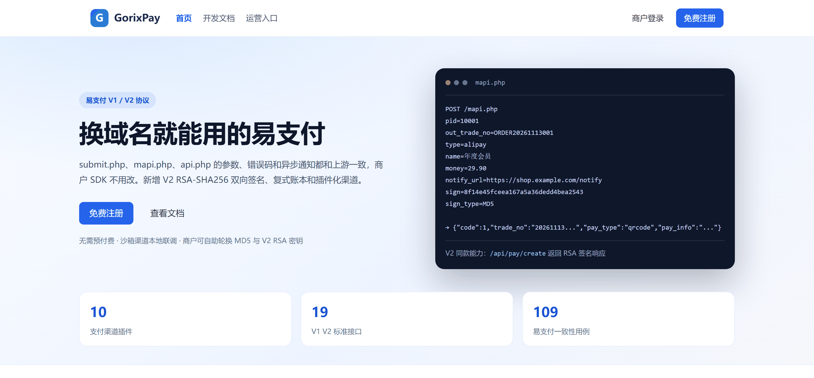
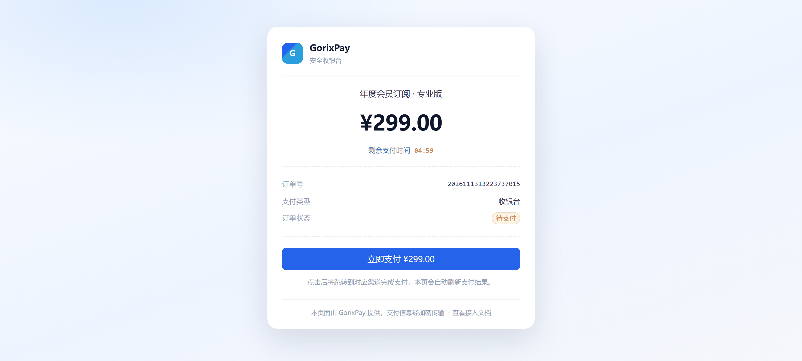
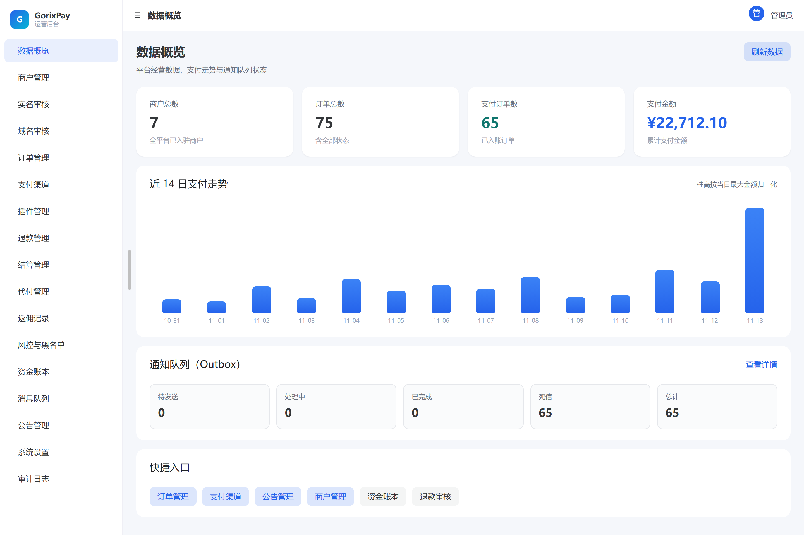
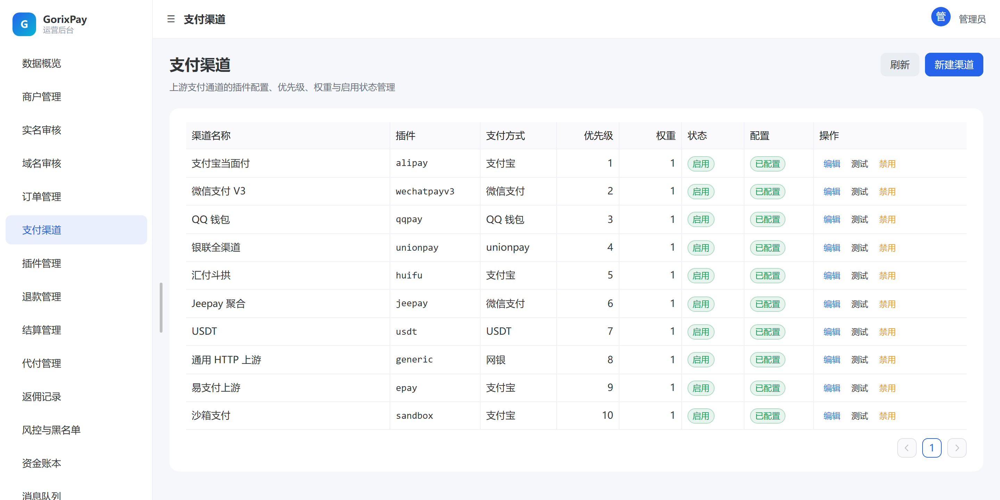
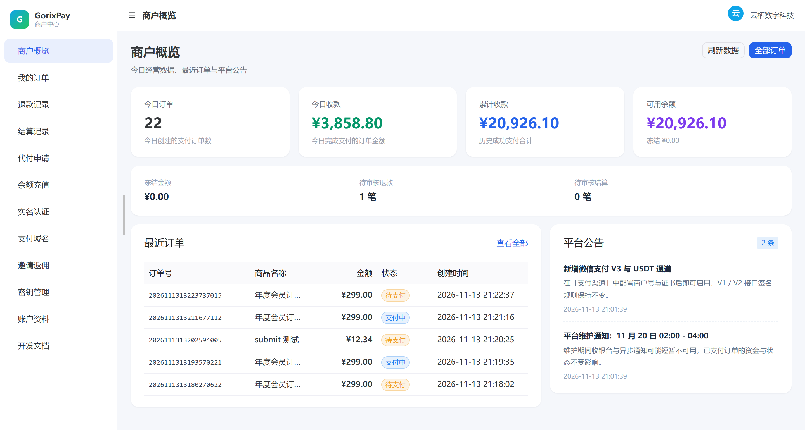
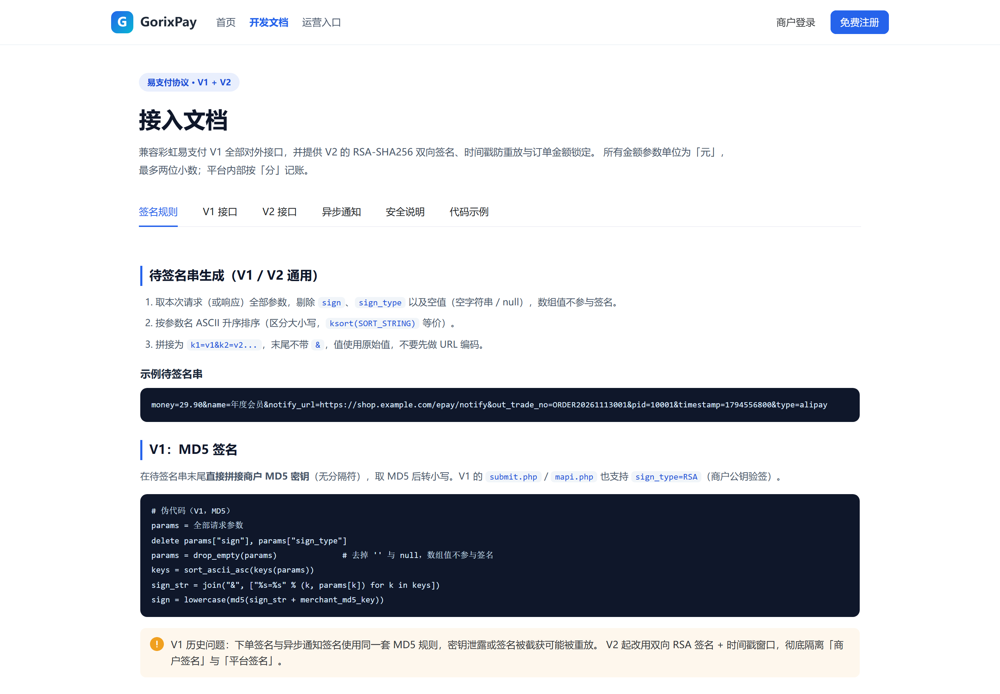
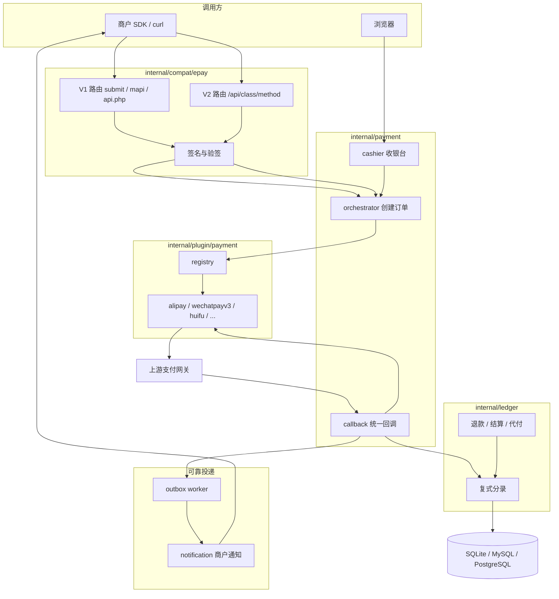

<p align="center">
  
</p>

<p align="center">
  <a href="https://github.com/Wu-jiyan/GorixPay/actions/workflows/ci.yml"></a>
  
  
  
  
  
</p>

<p align="center">
  <a href="README.en.md">English</a> ·
  <a href="docs/README.md">文档索引</a> ·
  <a href="docs/epay-compat-matrix.md">兼容性矩阵</a> ·
  <a href="docs/plugins.md">插件接入</a>
</p>

GorixPay 是彩虹易支付（Epay）的 Go 重写版，验收标准只有一条：商户把接口域名从 `pay.example.com` 换成你的地址，`submit.php`、`mapi.php`、`api.php?act=*` 的请求参数、返回字段、错误码和异步通知都不用改一行。

上游是一套 PHP 单体应用：商户余额记在用户表字段里，642 个 PHP 文件里光后台模板就有 `admin/` 下 55 个、`user/` 下 36 个，渠道逻辑散在 63 个 `plugins/` 目录里，签名默认 MD5（商户也可以自己配 RSA 密钥）。这次重写补了 V2 接口（RSA-SHA256 双向签名、时间戳窗口、防重放）、复式账本，以及一个能加渠道的插件层。协议面的兼容性由 109 条一致性用例守住，其中一部分用例会真的启动 PHP 执行上游源码函数，逐字节比对签名结果。

## 目录

- [现在能跑什么](#现在能跑什么)
- [界面](#界面)
- [对齐时修掉的 17 处偏差](#对齐时修掉的-17-处偏差)
- [上游的坑照抄了](#上游的坑照抄了)
- [兼容性怎么证明](#兼容性怎么证明)
- [协议面](#协议面)
- [支付渠道插件](#支付渠道插件)
- [资金与可靠性](#资金与可靠性)
- [架构](#架构)
- [五分钟跑起来](#五分钟跑起来)
- [测试](#测试)
- [部署](#部署)
- [从易支付迁移数据](#从易支付迁移数据)
- [已知限制](#已知限制)
- [文档](#文档)

## 现在能跑什么

| 能力 | 状态 |
| --- | --- |
| 易支付 V1：`submit.php`、`mapi.php`、`api.php?act=query\|order\|orders\|refund\|refundapi\|settle`、`submit2.php`、`/pay/{action}/{trade_no}/` | 完成，109 条一致性用例 |
| 易支付 V2：`pay/*`、`merchant/*`、`transfer/*` 共 12 个方法，`/api.php?s=class/method` 与路径等价 | 完成，含响应签名与防重放 |
| 支付渠道 | 10 个插件，其中汇付斗拱在真实网关下过 0.01 元订单 |
| 全站前端 | 59 个页面（官网、收银台、商户中心、运营后台），Naive UI |
| 资金 | 整数分复式账本、退款、结算、代付、余额充值、保证金 |
| 结算自动化 | 结算规则（最低金额、费率、周期）、按规则生成结算单、批量审核、审核通过后自动打款；后台每分钟巡检，同日幂等 |
| 分账与红包 | 分账接收方与费率、支付成功同事务分账（内部接收方走账本）、失败重试；红包按批次创建，金额随机且合计守恒 |
| 用户组与费率 | 商户分组、组内费率（万分比）、可用支付方式、结算模式；结算与分账自动套用 |
| 报表与导出 | 买家统计、商户统计（含手续费估算）、每日统计、商户资金明细；8 种 CSV 导出，带 BOM 与截断提示 |
| 投诉处理 | 登记、回复、关闭，超期自动派生 `overdue`；商户端只读自己的投诉，渠道自动拉取留了 `Puller` 接口 |
| 后台安全 | 自实现 RFC 6238 两步验证（密钥加密存储）、SVG 图形验证码（只存哈希、一次性）、登录尝试审计；登录按设置要求验证码与 TOTP |
| 支付方式与轮询 | 支付方式表（公开接口供收银台与官网使用）、按日权重轮询（当天有记录替换权重，0 表示当天不参与）、公众号配置（密钥加密） |
| 通知与找回密码 | 短信/邮件通道可配可测（未接网关时打到日志）、验证码限流、一次性重置 token、重置后作废会话、商户自助改密 |
| 第三方与扫码登录 | 微信/QQ/抖音 OAuth（一次性 state、绑定解绑），自绘 SVG 扫码登录（ticket 5 分钟、token 只发一次） |
| 设备与打印 | 语音播报与云端打印：设备用 `device_no`+密钥轮询，支付成功同事务入队播报与小票，未确认最多重投 3 次 |
| 用户组购买与运维 | 组买断价、余额扣款归组、退款解组；数据清理（白名单 + dry-run + 手输确认）、渠道测试支付、红包批次过期自动解冻 |
| 站点皮肤 | `site.skin` 三档（default / dark / compact），改名、Logo、页脚、皮肤都在后台改，刷新即生效 |
| 运营补口 | 后台手动与批量付款（批量失败整批回滚）、注册邀请码（并发不超发）、客诉自动规则（自动回复与超时关闭）、聚合收款码（真 QR）、商户自助测试支付、插件定时钩子 |
| 可靠性 | Transactional Outbox（租约认领 + CAS 更新），商户通知重试，Redis 可选 |
| 历史数据迁移 | `cmd/migrate-epay`，从 MySQL 或 SQLite 迁到 GorixPay，预检、dry-run、幂等 |
| 发版 | `v2.2.1`（2026-11-14）：首个 tag 是 2026-11-13 的 `v2.0.0` |

## 界面

截图来自本地实跑的服务，数据由 `scripts/e2e.ps1` 造出。

| 官网 | 收银台 |
| --- | --- |
|  |  |
| **运营后台概览** | **支付渠道** |
|  |  |
| **商户中心** | **开发文档** |
|  |  |

## 对齐时修掉的 17 处偏差

用上游自带的 `EpayCore` 客户端 SDK 打这个服务时暴露的问题。放着不管，商户用官方 SDK 要么拿到空字段，要么直接抛异常：

| 现象 | 上游依据 | 处理 |
| --- | --- | --- |
| `mapi.php` 只回 `pay_type`/`pay_info`，官方 SDK 读的是扁平字段，解析出来是空的 | `includes/lib/Payment.php:246-296` | 补 `payurl`/`qrcode`/`urlscheme`/`html`，旧字段留作别名 |
| 异步通知放在 POST body 里，商户在 `$_GET` 验签必然失败 | `includes/functions.php:519-522` | 改成 GET + query string |
| 通知格式只看商户有没有 RSA 凭证，V1 老集成会被换成 RSA | `includes/functions.php:503` | 新增 `payment_orders.version`，按订单版本选 MD5 或 RSA |
| 浏览器付款完不跳回 `return_url`，`verifyReturn()` 无从验签 | `includes/functions.php:519-531` | 补 `/pay/submit`、`/pay/checkpay`、`/pay/return`、`/pay/ok` 与收银台回跳 |
| 鉴权失败回 HTTP 401，上游自己从不回 4xx，.NET/Java 客户端会直接抛异常 | `includes/functions.php:1430` | JSON 入口回 200 + 失败码，页面入口回 200 + sysmsg 页 |
| `method`/`device`/`auth_code`/`is_applet` 完全没解析，扫码和 JSAPI 走不通 | `includes/lib/api/Pay.php:296-321` | 按 `getScanPayType` 的付款码前缀推钱包（25-30 支付宝、10-15 微信、91 QQ），并落库 `buyer` |

`mapi.php` 缺 `pid` 回 `-4`、`pid` 为空回 `-1`、商户不存在回 `-3`、签名错回 `-3`，这四种上游分得清，这里也分。17 处逐条列在 [`docs/epay-compat-matrix.md`](docs/epay-compat-matrix.md)。

## 上游的坑照抄了

有三处是上游自己的缺陷。改了会让现有调用方行为变化，所以照抄，只在测试里把行为钉住：

| 坑 | 上游依据 | 这里的处理 |
| --- | --- | --- |
| `merchant/orders` 用 POST 判断参数是否存在、用 GET 取值 | `includes/lib/Merchant.php:25` | 照抄，`TestV2MerchantOrdersStatusQuirk` 钉住 |
| `transfer/proof` 拿 `out_biz_no` 去查 `biz_no` 列 | `includes/lib/Transfer.php:94` | 照抄，`TestV2TransferProofQuirk` |
| `return_url` 自带 query 时，上游用 `&` 追加签名参数，商户自己的参数会进 `$_GET` 并破坏 `verifyReturn()` | `includes/functions.php:525-530` | 照抄，测试断言这个行为，没有改成「修好了」 |

另外 13 处是明确选择保留的差异：通知金额固定两位小数、`pay/close` 对已关闭订单幂等返回 `code=0`、V2 增加防重放。改动会影响现有调用方，理由一并记在兼容性矩阵里。

## 兼容性怎么证明

三层测试，每层管一段：

| 层 | 位置 | 管什么 | 缺了会怎样 |
| --- | --- | --- | --- |
| 契约夹具 | `tests/contracts/epay` | 把上游行为固化成 manifest 与 YAML 样本，字段和错误码不能悄悄变 | 只有「应该是什么」，证明不了服务真的这样回答 |
| 服务级一致性 | `tests/conformance/epay` | 启动真实 Gin 服务（内存 SQLite + sandbox 渠道 + 真商户凭据），用 HTTP 打每个入口 | 自己打自己，可能和上游一起跑偏 |
| 上游 oracle | `tests/conformance/epay/php` | 真 PHP 执行逐字复制的上游函数；再 `require` 上游的 `EpayCore.class.php` 跑全流程 | 需要机器上有 php 和上游源码，缺一样就跳过 |

```powershell
go test ./tests/conformance/epay -count=1 -v   # 63 个测试函数，109 条用例，15 秒上下
```

本机 PHP 7.4 加 `EPAY_UPSTREAM_DIR` 指向上游源码时 0 条 skip；PHP 8.3 也跑通全部 oracle 与 SDK 用例。CI 用 8.3，但没有上游源码，用到客户端 SDK 的 6 条会 skip，oracle 照跑。签名那部分是逐字节比对：`getSignContent` 的 ksort 字节序、不 URL 编码、不 trim、排除数组与空串，`md5(content+key)` 小写，RSA 用 SHA256 + PKCS#1 v1.5。签名结果以 PHP 的字节输出为准。

上游源码不进仓库（Apache-2.0 的仓库里塞一份别人的 PHP 源码，clone 体积和许可都难看）。需要跑 SDK 那几条用例时，把上游源码放到任意目录，用 `EPAY_UPSTREAM_DIR` 指过去；不放也能跑，那几条会 skip：

```powershell
$env:EPAY_UPSTREAM_DIR = "E:\epay-upstream\Epay"
```

## 协议面

### V1：MD5 或 RSA 参数签名，HTTP 永远 200

| 入口 | 说明 |
| --- | --- |
| `POST/GET /submit.php` | 页面跳转支付，GET 带 `pid` 时整组读 GET，否则读 POST |
| `POST /mapi.php` | API 支付，返回 `code`、`trade_no` 与扁平支付信息 |
| `GET /api.php?act=query` | 商户账户信息，明文 `pid` + `key` |
| `GET /api.php?act=order` | 单笔订单查询，支持 `sign=md5(SYS_KEY.trade_no.SYS_KEY)` 内部模式 |
| `GET /api.php?act=orders` | 订单列表，`limit` 上限 50 |
| `GET /api.php?act=settle` | 结算记录 |
| `POST /api.php?act=refund` | 退款，返回 `uid`/`reducemoney` |
| `POST /api.php?act=refundapi` | 内部退款，密钥 `md5(trade_no+SYS_KEY+trade_no)` |
| `GET /submit2.php` | 未支付订单回收银台，其余渲染 sysmsg 页 |
| `GET /pay/{submit,checkpay,return,ok}/{trade_no}/` | 收银台跳转、状态查询、浏览器回跳、成功页 |

### V2：RSA-SHA256 双向签名，`timestamp` ±300 秒

| 方法 | 说明 |
| --- | --- |
| `pay/submit` | 页面支付，唯一允许读 query 的方法 |
| `pay/create` | 创建订单，返回签名的 `pay_type`/`pay_info` |
| `pay/query` | 订单查询 |
| `pay/close` | 关单 |
| `pay/refund` / `pay/refundquery` | 退款与退款查询 |
| `merchant/info` / `merchant/orders` | 商户信息与订单列表，含上游的 `order_num*` 字段 |
| `transfer/submit` / `transfer/query` / `transfer/proof` / `transfer/balance` | 代付申请、查询、凭证、可提现余额 |

参数只读 POST 体（`ApiHelper.php:47`），签名错误统一 `-3`，未知路由 `-5`，异常响应不签名，业务失败仍签名。重放按签名哈希一次性消费，覆盖 `pay/refund`、`pay/close`、`transfer/*`；上游这几个接口没有防重放，这是一处刻意加固。

字段级说明见 [`docs/epay-v2.md`](docs/epay-v2.md)。

## 支付渠道插件

渠道是插件。插件声明自己需要哪些配置字段，运营后台按 `ConfigFields` 动态渲染表单，回调走同一个入口，插件只负责验签和返回 ack。

| 插件 | 覆盖方式 | 真实网关 |
| --- | --- | --- |
| `alipay` | 当面付（扫码 / 付款码） | 只有 mock 联调 |
| `wechatpayv3` | Native / JSAPI / H5 | 只有 mock 联调 |
| `qqpay` | QQ 钱包 | 只有 mock 联调 |
| `unionpay` | 银联全渠道 5.1.0 | 只有 mock 联调 |
| `huifu` | 汇付斗拱 v3 `jspay` + 回调 | 真实商户号下过单，验签通过 |
| `jeepay` | Jeepay 聚合 | 只有 mock 联调 |
| `usdt` | Epusdt 风格 | 只有 mock 联调 |
| `generic` | 通用 HTTP 上游，配置驱动 | 视上游而定 |
| `epay` | 接入另一套易支付 | 只有 mock 联调 |
| `sandbox` | 本地模拟支付，生产强制关闭 | 不需要 |

新增一个渠道要动的地方：实现 `Plugin`，需要配置表单再实现 `Configurable`，需要自定义回调验签再实现 `CallbackVerifier`，然后在 `internal/plugin/payment/registry.go` 注册，在 `tests/contracts/plugins/manifest.yaml` 补条目，在 `docs/plugins.md` 补一节字段说明。字段清单和 9 个渠道的真实凭据清单见 [`docs/plugins.md`](docs/plugins.md)。

## 资金与可靠性

- 所有金额是整数分，不用 float。账本用借贷分录，一张支付单产生的分录必须借贷平衡，不平直接回滚。
- 退款、结算、代付各自有过账路径，每笔带幂等键，同一 `out_trade_no` 重复提交不会重复出账。
- Outbox 消息带租约和 `attempts`，认领和完成都用条件更新，多副本一起跑不会重复消费；失败重试到上限进死信，后台可以重新入队。
- Redis 可选。配了就用它做 V2 防重放（`SET NX`）和收银台限流；没配时防重放落到 `epay_request_nonces` 表，收银台限流关闭，其它功能照常。

## 架构



完整链路、订单状态机、账本账户类型和模块边界上的妥协写在 [`docs/architecture.md`](docs/architecture.md)。

```text
cmd/gorixpay            主程序与 admin create 子命令
cmd/migrate-epay        易支付历史数据迁移
internal/compat/epay    V1/V2 协议、签名、密钥、页面
internal/payment        订单、编排、回调、收银台
internal/ledger         复式账本
internal/transfer       代付
internal/funding        余额充值与保证金
internal/certification  实名认证
internal/domainauth     支付域名白名单
internal/invite         邀请返佣
internal/risk           黑名单与限额
internal/notification   商户通知
internal/outbox         可靠投递
internal/merchant       商户端 API
internal/admin          运营端 API
internal/plugin/payment 渠道插件与注册表
internal/platform       配置、数据库、迁移、密钥、HTTP
```

## 五分钟跑起来

需要 Go 1.21+ 与 Node 20+。Windows PowerShell：

```powershell
# 主密钥，只生成一次，丢了所有加密字段都解不开
$bytes = New-Object byte[] 32
[Security.Cryptography.RandomNumberGenerator]::Create().GetBytes($bytes)
[IO.File]::WriteAllBytes("$PWD/master.key", $bytes)

# 前端产物由 Go 直接托管
Push-Location frontend
npm ci
npm run build
Pop-Location

# 默认 SQLite: gorixpay.db，监听 :8080
go run ./cmd/gorixpay --master-key-file master.key

# 另开一个终端建管理员
$env:GORIXPAY_ADMIN_PASSWORD = "change-me-please"
go run ./cmd/gorixpay admin create --username admin --display-name 管理员 `
  --password-env GORIXPAY_ADMIN_PASSWORD --master-key-file master.key
```

Linux / macOS 把第一步换成 `head -c 32 /dev/urandom > master.key`，其余一样。

打开：

- 官网 <http://localhost:8080/>
- 运营后台 <http://localhost:8080/admin/login>
- 商户注册 <http://localhost:8080/register>
- 开发文档 <http://localhost:8080/doc>
- 健康检查 `/health/live`、`/health/ready`

### 走一遍真实支付流程

1. 运营后台的「支付渠道」页点「新建渠道」：插件 `sandbox`、支付方式 `alipay`、`api_url=http://sandbox.local`、`pid=0`、`key=sandbox`；再建一个 `cashier` 方式，供余额充值和保证金使用。
2. 注册一个商户，在「密钥管理」里轮换一次 MD5 密钥，记下 `pid` 和密钥。
3. 用 V1 下单：

```powershell
curl.exe -X POST http://localhost:8080/mapi.php `
  -d "pid=10001" -d "type=alipay" -d "out_trade_no=TEST20261113001" `
  -d "notify_url=http://localhost:9999/notify" -d "return_url=http://localhost:9999/return" `
  -d "name=测试商品" -d "money=0.01" -d "clientip=127.0.0.1" -d "sign=<MD5签名>"
```

4. 打开返回的收银台链接，点「立即支付」，跳到 `/pay/sandbox/{trade_no}`，点「模拟支付成功」。
5. 订单变已支付，账本出分录，Outbox 生成一条商户通知。通知地址要能返回 `success`。

也可以直接跑脚本造数据：

```powershell
pwsh -File scripts/e2e.ps1 -BaseUrl http://localhost:8080
```

## 测试

```powershell
go build ./...
go vet ./...
go test ./...                                  # 66 个包，53 个有测试；607 条用例（含子用例）
npm --prefix frontend run build                # vue-tsc --noEmit + vite build
```

| 测试 | 防什么 |
| --- | --- |
| `internal/**/*_test.go` | 签名、金额、账本借贷平衡、状态机、插件解析、密钥加解密 |
| `tests/contracts/epay` | 字段名和错误码被悄悄改掉 |
| `tests/conformance/epay` | 真实 HTTP 行为偏离上游，109 条用例，含 PHP oracle |
| `tests/contracts/plugins` | 插件契约、mock 上游端到端、金额单位 |
| `internal/platform/app` 端到端 | 沙箱支付、实名、域名、返佣、风控、充值、保证金串起来还成立 |

一致性测试在没有 PHP 的机器上会自动跳过 oracle 与 SDK 用例，其余照跑。解释器不在 PATH 上时指定一个：

```powershell
$env:EPAY_PHP_BIN = "C:\php74\php.exe"
```

## 部署

三种方式，详细步骤在 [`docs/deployment.md`](docs/deployment.md)：Docker Compose（推荐）、Docker 单容器、源码编译加 systemd。想一条命令起站：

```bash
bash scripts/deploy.sh          # Linux，等价于下面的手动步骤，外加生成密钥、等健康检查
pwsh -File scripts/deploy.ps1   # Windows，加 -DryRun 只看不动
```

手动跑 Compose 的话，起来之前要准备两样东西，缺一样 `docker compose` 会直接报错停下：

```bash
# 1) 数据库口令与对外地址，compose 从同目录的 .env 读；口令同时给 postgres 和 GorixPay 的 DSN 用
cp deploy/.env.example deploy/.env   # 然后改 POSTGRES_PASSWORD 与 GORIXPAY_PUBLIC_URL

# 2) 主密钥：32 字节随机数，或这 32 字节的 base64
mkdir -p deploy/secrets
head -c 32 /dev/urandom | base64 > deploy/secrets/master_key.txt

docker compose -f deploy/compose.yaml up -d --build
```

Compose 起三个服务：`postgres:16-alpine`、`redis:7-alpine`、`gorixpay`。前端在镜像里的 `node:22-alpine` 阶段用 `npm ci && npm run build` 构建，运行镜像只拷 `dist`，所以不需要先在本地 build 一遍。依赖源默认走国内镜像，境外网络构建时传 `--build-arg NPM_REGISTRY=https://registry.npmjs.org --build-arg GOPROXY=https://proxy.golang.org,direct`。

容易踩的几处：

- `GORIXPAY_ENVIRONMENT=production` 时沙箱渠道一定不会注册，即使显式传 `--sandbox-enabled`（`config.Validate` 会把它按回 false）。
- 生产环境没有主密钥文件会直接启动失败；密钥文件内容写错了也会失败，它只认 32 字节原始内容或它们的 base64。
- `GORIXPAY_PUBLIC_URL` 必须是带 scheme 的绝对地址，收银台链接和回调地址都拿它拼。
- 配置优先级依次是命令行参数、环境变量、YAML 文件、默认值。Dockerfile 的默认 `CMD` 只给监听地址，数据库参数全部交给环境变量，避免命令行把 compose 的配置顶掉。

| 变量 | 说明 |
| --- | --- |
| `GORIXPAY_ENVIRONMENT` | `development` / `production` |
| `GORIXPAY_HTTP_ADDRESS` | 监听地址，默认 `:8080` |
| `GORIXPAY_PUBLIC_URL` | 对外地址，收银台与回调都用它拼 |
| `GORIXPAY_DATABASE_DRIVER` / `_DSN` | `sqlite` / `mysql` / `postgres` |
| `GORIXPAY_MASTER_KEY_FILE` | 主密钥文件路径，生产必填 |
| `GORIXPAY_REDIS_ADDR` | 留空则关闭 Redis |
| `GORIXPAY_REDIS_PASSWORD` / `_DB` / `_PREFIX` | Redis 认证、库号与键前缀 |
| `GORIXPAY_SANDBOX_ENABLED` | 沙箱渠道开关，production 下强制关闭 |
| `GORIXPAY_TRUSTED_PROXIES` | 逗号分隔的反代地址（如 `127.0.0.1,::1`）。留空则不信任任何 `X-Forwarded-For`，`ClientIP` 取 socket 对端地址 |
| `GORIXPAY_ALLOW_PRIVATE_NOTIFY_HOSTS` | 允许商户 `notify_url` 指向内网/本机（同机部署常需要）。默认关：默认只允许公网地址，且 `169.254.169.254` 这类元数据地址永远拒绝 |
| `GORIXPAY_NOTIFY_TIMEOUT_SECONDS` | 单次商户通知超时，默认 15 秒，上限 300 |

迁移文件是版本化 SQL，三种数据库共用一份，执行器按方言改写 MySQL 不支持的 `CREATE INDEX IF NOT EXISTS`、逐条执行语句（MySQL 默认禁用多语句），并在 PostgreSQL/MySQL 上先取咨询锁再迁移，两个实例同时启动不会互相踩。

## 从易支付迁移数据

```powershell
go run ./cmd/migrate-epay `
  --source-driver mysql --source-dsn "user:pass@tcp(127.0.0.1:3306)/epay?charset=utf8mb4" `
  --target-driver sqlite --target-dsn gorixpay.db `
  --master-key-file master.key `
  --dry-run --report migrate-report
```

先跑 `--dry-run` 看报告：表结构、重复订单号、负数金额、超精度金额都会在预检里列出来，有阻断项时退出码 2（用 `go run` 跑会被统一成 1，要看真实退出码就先 `go build -o migrate-epay ./cmd/migrate-epay`）。正式迁移按 `legacy_uid`、`trade_no`、`refund_no`、结算单号幂等，重复执行会跳过已迁记录。商户密码保留易支付的 MD5 哈希，首次登录成功后升级成 Argon2id。

## 已知限制

下面这些是真跑不动的部分，接了就会踩：

- 只有汇付斗拱走过真实网关。2026-11-13 用真实商户号下了 0.01 元订单，拿到 `qr.alipay.com` 的付款码，响应验签通过。其余八个渠道只有单测和 `httptest` 假上游，没有真商户号跑过，接之前先用 `scripts/plugin-sandbox-check.ps1` 拿真凭据打一遍。
- `huifu` 只做创建订单与回调。斗拱对 `jspay` 订单的关单接口在实测里回「交易不存在」，退款要另走接口，所以查单、关单、退款三个能力没实现。
- 上游 `plugins/` 下 63 个渠道插件是渠道商务关系，不是协议，长尾渠道用 `generic` 配置化接入。
- 管理后台是 Vue SPA，和上游那 55 个 `admin/*.php` 模板完全不像。只有 HTTP 协议面对齐，页面交互是重画的：代付审核有列表、通过、驳回，渠道进件没有做。
- **运营面没有代码层面的缺口了**，协议面也是全覆盖。四批补齐之后只剩两类：一类要渠道商务开通（支付宝与微信投诉自动拉取、渠道侧分账与直清、红包领取，钱到不了收款人只有冻结与审核），一类按设计不适用并写了理由（点金计划、企微客服、11 套模板、IP 库与 OCR、伪静态、`gettoken`）。公众号模板消息已实现，需要认证服务号与模板 ID，条件不满足时通知回退邮件与短信。逐项对照见 [`docs/epay-coverage.md`](docs/epay-coverage.md)，51 条判定里 47 条已实现、4 条不适用。
- V1 的 MD5 签名强度由上游决定。想用 RSA 就把商户切到 V2 凭证。
- `v2.0.0` 是第一个 tag，还没有长期兼容承诺：2.x 里接口和迁移文件仍可能动。

## 文档

| 文档 | 回答什么问题 |
| --- | --- |
| [`docs/epay-compat-matrix.md`](docs/epay-compat-matrix.md) | 每个入口对应上游哪一行，哪些偏差修了，哪些留着 |
| [`docs/epay-coverage.md`](docs/epay-coverage.md) | 上游每一个入口、后台页面、定时任务在我们这边是已实现、部分实现还是没做 |
| [`docs/deployment.md`](docs/deployment.md) | 三种部署方式、反向代理、备份恢复、升级回滚、排查表、生产检查清单 |
| [`docs/epay-v2.md`](docs/epay-v2.md) | V2 的签名、字段、错误码、防重放 |
| [`docs/epay-contract-baseline.md`](docs/epay-contract-baseline.md) | 契约基线从哪来，怎么冻结 |
| [`docs/plugins.md`](docs/plugins.md) | 插件契约、10 个插件的配置字段、回调、真网关凭据清单 |
| [`docs/architecture.md`](docs/architecture.md) | 分层、支付链路、状态机、账本、已知妥协 |
| [`CONTRIBUTING.md`](CONTRIBUTING.md) | 怎么加插件、怎么跑测试、PR 要带什么 |
| [`SECURITY.md`](SECURITY.md) | 信任边界、密钥、金额校验、漏洞上报 |
| [`CHANGELOG.md`](CHANGELOG.md) | 到目前为止做了什么 |

## 许可

Apache License 2.0，见 [`LICENSE`](LICENSE)。上游易支付源码不在本仓库内，只在本地做兼容性比对时使用，遵循其原有许可。
