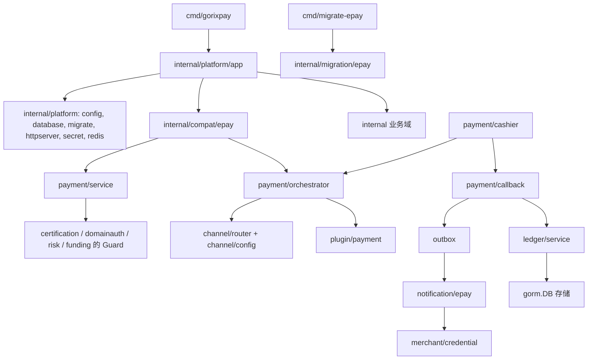

# GorixPay 架构说明

给接手这个仓库的工程师。读完应该能回答：请求从哪进来、钱怎么记、插件怎么插、哪些地方是硬凑出来的。

规模事实：仓库内 96 个非测试 Go 文件、67 个测试文件，共 163 个、25857 行（排除 `node_modules`，2026-11-13 计数）。装配集中在 `internal/platform/app/app.go` 的 `New`，该文件 305 行、`New` 一个函数占掉大半，读完它等于读完接线图。这份文档只描述代码现在的样子。

## 1. 分层与依赖方向

| 层 | 包 | 职责 |
| --- | --- | --- |
| 入口 | `cmd/gorixpay`、`cmd/migrate-epay` | 读配置、起 HTTP、跑迁移、建管理员 |
| 平台 | `internal/platform/{config,logging,httpserver,database,migrate,secret,redis,health,app}` | 进程级能力，无业务规则 |
| 兼容层 | `internal/compat/epay/{auth,payment,page,v2,signing,request}` | 易支付 V1/V2 报文语义 |
| 业务域 | `internal/{payment,ledger,finance,transfer,funding,certification,domainauth,invite,risk,announcement,identity,merchant,channel,admin,outbox,notification,plugin,migration}` | 订单、账、渠道、运营与风控 |
| 存储 | `migrations/*.sql` + GORM | 16 份 SQL，业务服务直接持 `*gorm.DB` |

没有 repository 层。业务服务在构造时拿 `*gorm.DB`，查询和事务边界都写在服务方法里，例如 `internal/ledger/service/service.go` 的 `PostInTransaction` 在一个事务里锁账户、写分录、改余额。



两条硬事实：

- `internal/platform/app` 只被 `cmd/gorixpay` 和一致性测试 harness 引用，业务包不 import 它。业务包从平台层能拿到的只有 `secret.Cipher`，以及迁移 CLI 用的 `config`/`database`/`migrate`。
- 业务包之间自由引用，编译器只拦循环。`internal/compat/epay/payment` 直接 import `payment/service`、`payment/orchestrator`、`plugin/payment`；`payment/cashier` 又 import `payment/callback`。

## 2. 一次支付请求的完整链路

以 `POST /mapi.php` 为例，走完下单到商户收到通知。

1. 认证与参数分组。`epayauth.Middleware`（`internal/compat/epay/auth/middleware.go`）按 `pid` 查 `merchants.legacy_uid`，`sign_type` 缺省 MD5，用 `merchant/credential` 的活跃密钥验签，失败写 HTTP 200 加 `{"code":-3}`，因为上游 `echojsonmsg` 从不返回 4xx。`submit.php` 用 `HTMLMiddleware` 输出 sysmsg 页面，`selectSubmitParameters`（`internal/compat/epay/payment/handler.go`）先按 query 是否带 `pid` 丢掉另一组参数，避免未签名的分组覆盖已签字段。
2. 解析成命令。`commandFromRequest`（同文件）做字段白名单、`outTradeNoPattern`、`notifyURLPattern` 校验，金额元转分走 `ParseAmount`。
3. 落库。`paymentservice.Service.Create`（`internal/payment/service/create.go`）先跑 Guard 链（`app.go` 里用 `WithGuards` 挂了认证、域名、风控、保证金四个），再按 `(merchant_id, out_trade_no)` 幂等，`generateTradeNo` 出 19 位单号（14 位时间戳加 5 位序号），状态 `pending`，`expires_at` 为当前加 5 分钟。
4. 选通道。`handler.startPayment` 调 `orchestrator.StartWithOptions`（`internal/payment/orchestrator/service.go`），`channel/router.Select` 取同优先级里按 `weight` 随机的 active 通道，`channel/config` 解密出 `Values()`（`extra` 覆盖 `api_url`、`pid`、`key`），`claim` 把订单改成 `processing` 并插入 `payment_attempts` 行（状态 `creating`）。
5. 插件下单。`plugin.CreatePayment`（`internal/plugin/payment/contract.go` 的 `Plugin` 接口）拿到 `CreateRequest`，其中 `NotifyURL` 被改写成 `{PublicURL}/api/v1/payment/callback/{plugin_code}/{channel_id}`。成功把 `Action` 序列化进 `payment_attempts.action_type/action_payload`；失败把 attempt 置 `failed`、订单退回 `pending`，V1 返回 `code=-2`。
6. 收银台。`payment/cashier` 的 `Register` 挂 `POST /api/v1/cashier/orders/:trade_no/start` 与 `GET .../status`，start 有 Redis 限流（`Limiter` 为 nil 时不限）、过期判断，订单已在 `processing` 就直接回放 `storedAction` 里的 action。浏览器路径还有 `compat/epay/page` 的 `/pay/submit/{trade_no}/`、`/pay/return/{trade_no}/`，后者的查询串必须带签名，签名参数来自 `notification/epay` 的 `NotificationValues`。
7. 上游回调。`callback.RegisterPlugins`（`internal/payment/callback/plugin.go`）按 `id + plugin_code + status=active` 取通道，解密配置，把请求交给 `CallbackVerifier`。验签通过但 `Paid=false` 的事件直接回 ack 不记账；`Amount != order.Amount` 返回 400；余下走 `callback.Service.Complete`。幂等键 `Digest = sha256(plugin + "\n" + channelID + "\n" + 原始 body)` 落在 `payment_callbacks.digest` 唯一索引上，同一条报文重放不会二次入账。易支付自有通道走另一条 `RegisterEpay`（`internal/payment/callback/http.go`），两条实现并存。
8. 状态与账。`Complete`（`internal/payment/callback/service.go`）在同一个事务里：`pending|processing` 改 `paid` 并写 `channel_trade_no`、`paid_at`，插 `payment_callbacks`，`IsSale()` 时插 Outbox 消息（topic `merchant.payment.notify`，键 `merchant-payment-notify:{orderID}`），`IsSale()` 或 `Kind=recharge` 时 `postIncome` 记商户余额，最后按顺序跑 `PostPaymentHook`（保证金、返佣）。
9. 投递与通知。`outbox.Worker.ProcessOne`（`internal/outbox/worker.go`）用租约抢占一条消息，默认 1 分钟租约、5 次上限、2 的幂次退避且封顶在 512 分钟，失败写 `last_error`。`notification/epay.Sender.Handle` 按 `AggregateID` 取订单，要求订单已 `paid`、商户有 `legacy_uid`，把签名参数拼进 `notify_url` 的查询串后发 GET，响应体包含 `success`（大小写三种）才算成功。订单 `version >= 1` 且商户有活跃 RSA 凭据时改发 `sign_type=RSA` 的通知。

| 步骤 | 入口 | 关键函数 | 写库 |
| --- | --- | --- | --- |
| 下单 | `/mapi.php`、`/submit.php`、`/api.php`、`/api/{class}/{method}` | `commandFromRequest`、`Service.Create` | `payment_orders` |
| 启动 | 收银台 start、V1/V2 下单同请求 | `StartWithOptions`、`Router.Select`、`claim` | `payment_attempts`、订单状态 |
| 回调 | `/api/v1/payment/callback/{plugin}/{channel_id}`、`/api/v1/payment/callback/epay/:channel_id` | `VerifyCallback`、`Service.Complete` | `payment_callbacks`、`ledger_*`、`outbox_messages` |
| 通知 | Outbox worker | `Sender.Handle`、`NotificationValues` | `outbox_messages` 状态 |

## 3. 订单状态机

状态定义在 `internal/payment/model/order.go`：`pending`、`processing`、`paid`、`closed`、`failed`。

| 当前 | 允许迁到 | 代码位置 |
| --- | --- | --- |
| `pending` | `processing`、`paid`、`closed`、`failed` | `Order.Transition`（`model/order.go:71`） |
| `processing` | `paid`、`closed`、`failed` | 同上 |
| `paid`、`closed`、`failed` | 无 | `Order.Terminal()` |

实际写状态的地方分散，都用 GORM `Updates` 直接改列，不调 `Transition`：

- `pending` 到 `processing`：`orchestrator.claim`，带 `status = pending` 条件做 CAS。
- `processing` 到 `pending`：插件下单失败时回滚，`orchestrator/service.go` 的失败分支。
- 到 `paid`：`callback/service.go` 的 `Complete`，条件是 `status IN (pending, processing)`。
- 到 `closed`：`payment/service/order.go` 的 `Close`（商户关单）、`admin/httpapi/handler.go` 的管理端关单。
- `failed` 只在读取侧出现：V1 `api.php`、V2 的 `merchant/orders`、收银台、管理端列表拿它做过滤和拒绝分支，非测试代码里没有写入点。

`Transition` 在非测试代码里没有调用方（`Select-String -Pattern '\.Transition\('` 命中 0）。状态机停留在模型层的文档，第 7 节第 1 条记录了这个后果。

## 4. 复式账本

模型在 `internal/ledger/model/model.go`，服务在 `internal/ledger/service/service.go`。金额一律 `int64` 分。

| 表 | 关键列 | 约束 |
| --- | --- | --- |
| `ledger_accounts` | `owner_type`、`owner_id`、`purpose`、`category`、`currency` | 四元组唯一 |
| `ledger_transactions` | `idempotency_key` 唯一、`reference_type`、`reference_id`、`metadata` | 有 `BeforeUpdate`/`BeforeDelete` 钩子返回 `ErrImmutable` |
| `ledger_entries` | `transaction_id`、`sequence`、`direction`、`bucket`、`amount`、`balance_after` | `(transaction_id, sequence)` 唯一，同样不可改 |
| `ledger_balances` | `available`、`frozen`、`version` | 乐观锁，更新带 `version` 条件 |
| `ledger_freezes` | `business_key` 唯一、`status`、冻结与释放的分录 ID | 释放幂等 |
| `ledger_operations` | 待审批的转账操作，`status` 三态 | 审批后生成一条普通交易 |

账户按 `(owner_type, purpose)` 分配，`category` 决定借贷方向：`asset`、`expense` 借记增，`liability`、`equity`、`revenue` 贷记增（`naturalDelta`）。代码自动创建的账户有三种：商户余额 `merchant/balance`（liability）、商户保证金 `merchant/deposit`（liability）、平台现金 `platform/cash`（asset）；管理端 `POST /ledger/accounts` 可以再建任意组合。

`PostInTransaction` 的校验顺序：条目至少两条、借贷金额相等（不等返回 `ErrUnbalanced`）、账户存在且 `active`、锁账户与余额（`clause.Locking`）、逐条算 `balance_after`、任一桶为负返回 `ErrInsufficientBalance`、写交易与分录、按 `version` 更新余额。

各业务路径的过账形态：

| 场景 | 分录 | 幂等键 | 代码 |
| --- | --- | --- | --- |
| 支付入账 | 商户 `balance` 贷 / 平台 `cash` 借 | `payment:{orderID}` | `callback/service.go` 的 `postIncome` |
| 充值 | 同上，订单 `Kind=recharge` | `payment:{orderID}` | 同上 |
| 保证金 | 商户 `deposit` 贷 / 平台 `cash` 借 | `deposit:{orderID}` | `funding/service.go` 的 `OnPayment` |
| 退款 | 商户 `balance` 借 / 平台 `cash` 贷 | `refund:{refundID}` | `finance/service/service.go` 的 `finishRefund` |
| 结算 | 商户 `balance` 借 / 平台 `cash` 贷 | `settlement:{settlementID}` | 同文件的 `finishSettlement` |
| 代付冻结 | 商户 `balance` 可用桶转冻结桶 | `freeze:transfer:{orderID}` | `transfer/service.go` 调 `ledger.Freeze` |
| 代付放款 | 商户 `balance` 借 / 平台 `cash` 贷，先释放冻结 | `transfer-settle:{orderID}`、`release:transfer:{orderID}` | `transfer/service.go` 的 `process` |
| 邀请返佣 | 邀请人 `balance` 贷 / 平台 `cash` 借 | `rebate:{orderID}` | `invite/service.go` 的 `OnPayment` |
| 认证费 | 商户 `balance` 借 / 平台 `cash` 贷 | `cert-fee:{merchantID}` | `certification/service.go` |
| 历史迁移期初 | 商户 `balance` 贷 / 平台 `cash` 借 | `opening-balance:{legacyUID}` | `migration/epay/balances.go` |
| 手工转账审批 | 两条分录，方向按 `category` 推 | `ledger-operation:{operationID}` | `ledger/service` 的 `ProcessOperation` |

冻结与释放共用一条规则：`freeze:{businessKey}` 与 `release:{businessKey}`，同一账户两个桶内部划转，天然平衡。所有键都是业务主键拼接，重放时 `PostInTransaction` 先查 `idempotency_key`，命中且请求哈希一致就返回原交易（`Replayed=true`），哈希不一致返回 `ErrIdempotencyConflict`。

## 5. 插件契约

三个接口都在 `internal/plugin/payment/contract.go`。

```go
type Plugin interface {
    Metadata() Metadata
    CreatePayment(context.Context, CreateRequest) (Action, error)
}

type Configurable interface {
    ConfigFields() []ConfigField
}

type CallbackVerifier interface {
    VerifyCallback(ctx context.Context, r *http.Request, config map[string]string) (CallbackResult, error)
}
```

`CallbackResult` 的字段是 `TradeNo`、`ChannelTradeNo`、`Amount`（分）、`Paid`、`Raw`、`Ack`。

注册表 `internal/plugin/payment/registry.go`，`Register` 校验三件事：code 匹配 `^[a-z][a-z0-9_-]{1,63}$`、`Name` 非空、能力列表非空且不重复；`Resolve(code, capability)` 供通道选择用，`Lookup(code)` 供回调与脚本用，`List()`/`ConfigFields(code)` 供管理端 `/api/v1/admin/plugins` 渲染表单。默认注册 9 个：`epay`、`alipay`、`wechatpayv3`、`jeepay`、`generic`、`huifu`、`usdt`、`qqpay`、`unionpay`；`sandbox` 仅在 `cfg.Sandbox.Enabled` 且环境非 production 时追加。

回调分发在 `internal/payment/callback/plugin.go`：取通道、解密配置、`plugins.Lookup(channel.PluginCode)`、类型断言到 `CallbackVerifier`、把 rewound 后的原始 body 交给插件。插件自己管签名（支付宝 RSA2、微信平台证书加 AES-GCM、Jeepay/QQ/USDT 的 MD5、汇付的 canonical JSON、银联的排序拼串），handler 只管金额比对、幂等和状态。

`Ack` 解决非标准应答：`acknowledgement(result.Ack)` 在 `Ack` 为空时回 `success`，非空时原样回。汇付斗拱是唯一用到它的插件，回 `RECV_ORD_ID_<trade_no>`，别的字符串会被反复重推。`Action` 有九种类型，`Validate` 对 `jump` 要求 http(s) 绝对地址，对 `qrcode` 放行 `weixin://` 这类自定义 scheme。

## 6. 数据库与迁移

16 份 SQL 放在 `migrations/`，通过 `//go:embed *.sql` 编进二进制（`migrations/embed.go`），`migrate.Runner{DB, FS}.Up` 按文件名排序执行。

| 段 | 文件 | 内容 |
| --- | --- | --- |
| 基础 | `000001`、`000006`、`000010` | `system_settings`/`audit_events`、`outbox_messages`、`epay_request_nonces` |
| 身份与通道 | `000002`、`000004` | 商户、凭据、管理员、会话、`payment_channels` |
| 支付主干 | `000003`、`000005`、`000014`、`000015` | `payment_orders`、`payment_attempts`、`payment_callbacks`、订单 `version` 与 `buyer` |
| 账与资金 | `000007`、`000008`、`000009`、`000013`、`000016` | 账本五表、待审操作、退款结算、订单 `kind`、商户结算资料 |
| 代付与运营域 | `000011`、`000012` | `transfer_orders`、公告、`payment_attempts` 的 action 列；认证、域名、返佣、黑名单、风控事件 |

三方言共用同一套 SQL：写法限制在 `CREATE TABLE IF NOT EXISTS`、`CREATE INDEX IF NOT EXISTS`、`ALTER TABLE ADD COLUMN` 这类 SQLite、MySQL、PostgreSQL 都能解析的子集，类型用 `VARCHAR`、`TIMESTAMP`、`BIGINT`。

MySQL 的降级只有一处：`internal/platform/migrate/migrate.go` 的 `prepareMigration`，用正则把 `CREATE (UNIQUE )?INDEX IF NOT EXISTS` 改写成 `CREATE (UNIQUE )?INDEX`，因为 MySQL 不认 `IF NOT EXISTS`。注释里写明了前提：迁移按版本只跑一次。`ALTER TABLE ADD COLUMN` 没有做同类改写，靠 `schema_migrations` 记录兜住。

执行器本身的约束：`schema_migrations` 由 GORM `AutoMigrate` 建，`version` 主键、`checksum` 存 sha256，已执行的版本重新计算后不一致就报 `migration %s checksum drift`，每份 SQL 在一个事务里执行。SQLite 走单连接加 `PRAGMA foreign_keys = ON`、`busy_timeout = 5000`，其它方言 25 个连接（`platform/database/database.go`）。

`internal/platform/database/dialect.go` 声明了 `Name()`、`BindVar()`、`SupportsSkipLocked()` 三个能力，除自身与测试外没有调用点（`NewDialect` 本身在 `database.go:18` 被调用），写手写 SQL 时也用不上它。

## 7. 已知妥协

1. 订单状态机没有执行点。`Order.Transition` 零调用，所有迁移是 `Updates` 直接改列，条件写在 `WHERE status = ...` 里。想加一条“只允许 pending 到 processing”的规则，得改十几处。
2. 两套回调解读。`payment/callback/http.go` 的易支付通道自己 `ParseForm`、自己 `parseCallbackAmount`、自己拼 digest；通用入口在 `plugin.go`，用 `pluginpayment.ParseAmount`。金额解析因此有四份实现，另外两份是 V1 handler 的 `ParseAmount` 和 `v2/amount.go` 的 `ParseAmount`，后者多一条 100000.00 的上限。
3. `/api/pay/query`、`/api/pay/close` 是同一条路径上的两代协议。`delegateV2`（`compat/epay/payment/handler.go`）看表单里的 `sign_type` 是不是 `RSA`，据此决定交给 V2 还是走 V1，路由本身分不开这两代。
4. `api.php` 自带 `authenticate`（`compat/epay/payment/api.go`），绕过 `auth.Middleware`，因为它多一条系统签名分支（`orderBySystemSign`、`systemKey`）。同一套验签规则存在两份代码。
5. `compat/epay/page` 依赖通知域。`page.Signer` 的注释写着“epay 通知 sender 实现它”，也就是浏览器回跳页和异步通知共用 `NotificationValues`。兼容层反向依赖 `notification/epay`，靠接口解耦，实现只有那一个。
6. `compat/epay/payment.Register` 顺带注册了 `GET /api/v1/cashier/orders/:trade_no`，收银台的只读接口挂在兼容层的注册函数里。
7. `cashier.Deps.Orders` 保留但不用。结构体注释直说收银台改走 `DB` 读订单，字段留着是布线契约。
8. `system_settings` 的读取逻辑复制在七个包里：`certification/settings.go`、`domainauth/service.go`、`invite/service.go`、`risk/service.go`、`funding/service.go`、`announcement/service.go`，还有 `migration/epay/catalog.go`，每个包各自查表加默认值。没有统一的设置服务。
9. `PostPaymentHook` 的断言方向不一致。`funding/service.go` 写了 `var _ paymentcallback.PostPaymentHook = (*Service)(nil)`，为此 import 了支付域；`invite` 靠结构匹配实现同一接口，不 import。想换 hook 签名时，这两处行为不同。
10. `platform/database.Dialect` 是空抽象。`BindVar`、`SupportsSkipLocked` 无调用点，Outbox 抢占是 `SELECT` 后 `UPDATE` 带条件，不依赖 `SKIP LOCKED`。
11. 装配与开关耦合。`app.go` 的 `if cfg.Security.MasterKeyFile != ""` 包住了全部业务路由，没有主密钥时服务能起来但只剩健康检查、登录和 SPA。整个装配写在 `New` 一个函数里（该文件 305 行），加一个域就要在这里接一次线。
12. 商户通知要求 `legacy_uid`。`notification/epay.Sender.Handle` 在商户没有 `legacy_uid` 时返回错误，通知进 `dead` 状态，因为易支付协议里 `pid` 就是这个数字。
